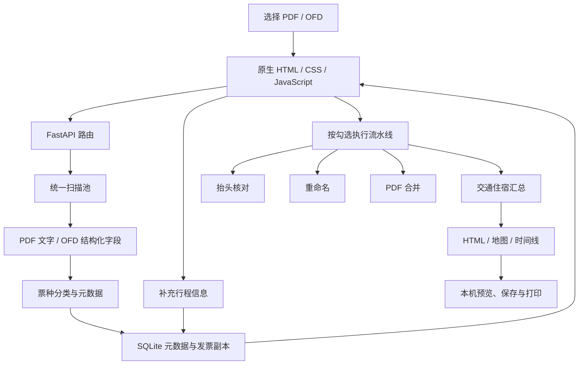

# 架构与数据流

报销助手采用本机 HTTP 服务和浏览器界面。PyInstaller 将解释器、业务模块和静态资源放入单个 exe；运行时解压资源，用户数据保存在当前 Windows 用户目录。

## 模块职责

| 层 | 主要模块 | 职责 |
| --- | --- | --- |
| 入口 | `server/main.py` | 本机绑定、Host 和写请求 Origin 约束、路由和静态资源、就绪后打开浏览器 |
| HTTP | `routes/pool.py`、`pipeline.py`、`vault.py`、`trip.py` | 文件入口、扫描快照、操作编排、发票库和报告接口 |
| 解析 | `core/parse.py`、`facets.py` | PDF/OFD 字段提取、分类与元数据，不依赖界面 |
| 行程 | `core/journey_info.py`、`trip.py`、`trip_summary.py`、`trip_html.py` | 完整度、人工补充、交通住宿关联、报告和地图 |
| 发票库 | `core/vault.py` | SQLite 记录、文件副本、元数据缓存和手动修正持久化 |
| 操作 | `core/check.py`、`rename.py`、`merge.py` | 核对、命名和 PDF 合并 |
| 界面 | `web/js/workbench.js`、`vault.js`、`settings.js` | 选择筛选、详情编辑、模块开关、设置及状态反馈 |

## 关键状态与规则

1. 导入统一解析，生成扫描快照并保存副本；后续模块复用元数据。
2. 工作台选择、票种筛选和行程生成范围分别维护。发票库每次进入产生本次新增选择，返回后追加并去重。
3. 解析状态、行程信息完整度和抬头核对表示不同事实；成功解析不代表必要行程字段齐全。
4. 人工补充写回发票库，工作台与报告读取修正后的信息。住宿采用入住/退房日期，不把购买方公司当作入住人。
5. 报告先写入本机报告目录，用户保存时才写到输出位置；导入不会创建桌面输出文件夹。

## 运行边界

- 源码版使用 8765，便携版使用 8766。测试必须使用其他端口及独立数据目录。
- `FAPIAO_LIB_ROOT`、`FAPIAO_PREVIEW_ROOT`、`FAPIAO_UPLOAD_ROOT`、`FAPIAO_DEFAULT_OUT_ROOT` 用于隔离验证。
- 业务规则留在 `core/`，避免前端和路由复制实现；前端没有 npm 构建流程。
- 原地重命名由用户明确触发，验证只使用虚构票据和临时目录。
- 当前适合个人本机使用，没有多用户、云端同步或远程服务架构。
